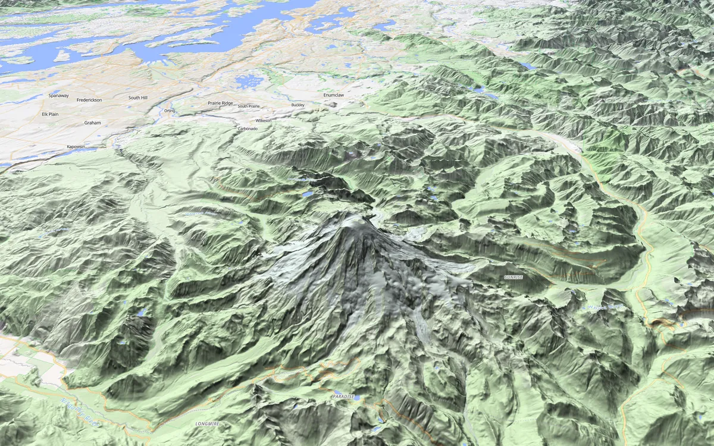
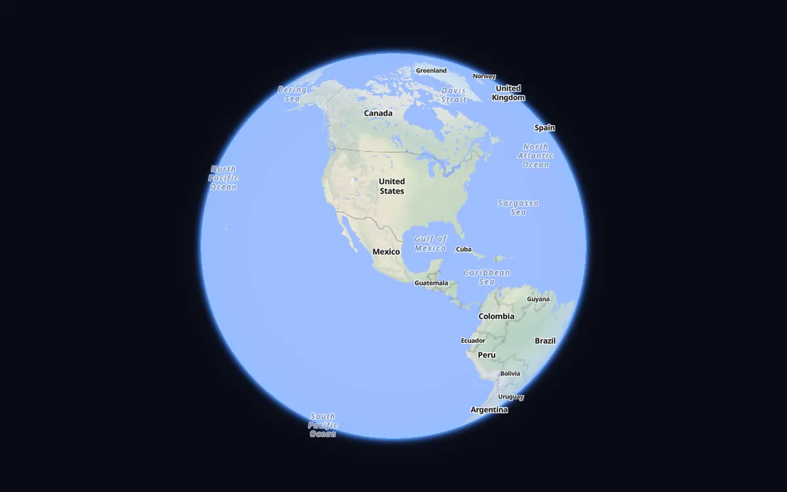

<p align="center">
  <picture>
    <source media="(prefers-color-scheme: dark)" srcset="assets/mapkern-logo-white.svg">
    
  </picture>
</p>

Mapkern Native is the C++ version of [Mapkern GL JS](https://github.com/grangedevgroup-code/mapkern-gl-js). It draws the same maps, as a flat map, in 3D over real terrain or as a globe, inside native apps on Android and Fire tablets, iOS, macOS, Windows and Linux. There's no API key and no tile server to set up: a new map shows the whole world from the free [OpenFreeMap](https://openfreemap.org/) Liberty style.

<p>
  
  
</p>

<sub>Map data © OpenStreetMap contributors, OpenFreeMap, OpenMapTiles and Mapterhorn</sub>

To see it before writing any code, download the package for your computer from the [latest release](https://github.com/grangedevgroup-code/mapkern-native/releases/latest) and run `bin/mapkern-viewer`, or install `mapkern-demo.apk` on an Android device. The viewer isn't signed, so Windows and macOS will ask you to confirm the first time.

## Android

Download [`mapkern.aar`](https://github.com/grangedevgroup-code/mapkern-native/releases/latest/download/mapkern.aar) into your app's `libs` folder and add it to `build.gradle.kts`:

```kotlin
dependencies {
    implementation(files("libs/mapkern.aar"))
}
```

Then put a `MapView` on the screen. It works from Android 7 on, asks for the internet permission itself, and follows the activity's lifecycle on its own:

```kotlin
class MainActivity : Activity() {
    override fun onCreate(savedInstanceState: Bundle?) {
        super.onCreate(savedInstanceState)
        val map = MapView(this, options = MapOptions(longitude = -122.33, latitude = 47.61, zoom = 11.0, controls = true))
        setContentView(map)
    }
}
```

In Compose, wrap it in an `AndroidView`:

```kotlin
AndroidView(factory = { MapView(it, options = MapOptions(longitude = -122.33, latitude = 47.61, zoom = 11.0)) })
```

## iOS and macOS

In Xcode, choose File > Add Package Dependencies and paste `https://github.com/grangedevgroup-code/mapkern-native`. SwiftUI apps use `MapkernMap`:

```swift
import Mapkern
import SwiftUI

struct ContentView: View {
    var body: some View {
        MapkernMap(options: MapOptions(longitude: -122.33, latitude: 47.61, zoom: 11, controls: true))
            .ignoresSafeArea()
    }
}
```

In UIKit or AppKit, `MapView` is an `MTKView`, so it goes anywhere a view does:

```swift
let map = MapView(frame: bounds, options: MapOptions(longitude: -122.33, latitude: 47.61, zoom: 11, controls: true))
```

## Windows

Download the two `.nupkg` files from the [latest release](https://github.com/grangedevgroup-code/mapkern-native/releases/latest) into a `packages` folder and add the package from there. It needs .NET 10 and carries the native library with it. On a build server, list that folder in a `nuget.config` too:

```sh
dotnet add package Mapkern.Native.WinForms --source ./packages
```

```csharp
var map = new MapControl(new MapOptions { Longitude = -122.33, Latitude = 47.61, Zoom = 11, Controls = true }) { Dock = DockStyle.Fill };
form.Controls.Add(map);
map.WhenReady(view => view.SetGlobe(false));
```

`map.Map` is empty until the control has a window, so `WhenReady` is the place for your first calls.

## C++

CMake fetches and builds the engine for you on Windows, macOS and Linux. On Linux, install `libcurl4-openssl-dev libgl-dev libegl-dev libx11-dev libxi-dev libxcursor-dev` first. `runWindow` opens a window with pan, zoom and rotate already wired up, which is all a small tool needs:

```cmake
cmake_minimum_required(VERSION 3.24)
project(hello LANGUAGES C CXX)

include(FetchContent)
FetchContent_Declare(mapkern URL https://github.com/grangedevgroup-code/mapkern-native/archive/refs/tags/v0.1.0.tar.gz)
FetchContent_MakeAvailable(mapkern)

add_executable(hello main.cpp)
target_link_libraries(hello PRIVATE mapkern_window)
```

```cpp
#include "mapkern/window.hpp"

int main() {
  mapkern::MapOptions options;
  options.lng = -122.33;
  options.lat = 47.61;
  options.zoom = 11;
  options.controls = true;
  return mapkern::runWindow(options);
}
```

[`examples/hello`](examples/hello) is this program with some data on it. If you have your own window, link `mapkern` instead, then call `initGraphics` once and `render` every frame with your own Direct3D, Metal or OpenGL surface, and pass input to `pointerDown`, `pointerMove`, `pointerUp` and `wheel`. Any other language can use the C API in [`include/mapkern/mapkern.h`](include/mapkern/mapkern.h), which ships with a prebuilt library for each desktop in the release.

## Your own data

Every SDK has the same calls. Sources and layers are JSON, in the same format as [Mapkern GL JS styles](https://github.com/grangedevgroup-code/mapkern-gl-js/blob/main/docs/style.md), and you can add them right after creating the map, before the style has loaded. This is Kotlin; Swift, C# and C++ read the same way, with the first letter of each C# method in capitals:

```kotlin
map.addSource("places", """{ "type": "geojson", "data": {
    "type": "Feature",
    "properties": { "name": "Space Needle" },
    "geometry": { "type": "Point", "coordinates": [-122.3493, 47.6205] }
} }""")

map.addLayer("""{ "id": "dots", "type": "circle", "source": "places",
    "paint": { "radius": 9, "color": "#d01f4f", "strokeWidth": 2, "strokeColor": "#ffffff" } }""")
```

`data` can also be a URL. To change it while the map runs, `map.setGeoJson("places", json)` swaps in the new data, and what's on screen stays until the new tiles are ready. A misspelled layer or property doesn't fail silently: it arrives as an `error` event that says what's wrong.

Taps come in as clicks, and `queryFeatures` tells you what's under one. It returns GeoJSON features with their `properties`, `geometry` and `layer`:

```kotlin
map.onClick { click ->
    map.queryFeatures(click.x, click.y, listOf("dots")) { features ->
        if (features.length() > 0) showDetails(features.getJSONObject(0).getJSONObject("properties"))
    }
}
```

## Moving around

`flyTo`, `easeTo` and `jumpTo` move the camera, and `setGlobe` switches between the globe and the flat map. For 3D terrain, add an elevation source and turn it on:

```kotlin
map.addSource("dem", """{ "type": "dem", "tiles": ["https://tiles.mapterhorn.com/{z}/{x}/{y}.webp"], "tileSize": 512, "maxZoom": 12, "encoding": "terrarium", "attribution": "© Mapterhorn" }""")
map.setTerrain("dem", exaggeration = 1.5)
map.flyTo(-121.76, 46.85, 11.0, pitch = 60.0)
```

With `controls = true` you also get the buttons from the GL JS demo: basemap, 2D/3D/globe, zoom, compass and scale.

## Styles and files

`setStyle` takes Mapkern's own style format or a MapLibre or Mapbox v8 style, which it converts on load, as a URL or as JSON. Tiles come from URLs, TileJSON, PMTiles and MBTiles files, local or over HTTP range requests. Elevation can be Terrarium or Mapbox encoded PNG or WebP tiles. Every response goes through a disk cache, so places you've seen keep working offline, and `downloadRegion` fills the cache for an area ahead of time.

GL JS still does a few things this engine doesn't, among them clustering, the extra file formats such as KML and GPX, markers, heatmaps, search and routing. Fill patterns aren't drawn yet either. If a style uses something it can't draw, that part is left out and the rest still shows.

## Building from source

You need CMake 4 and Ninja. On Windows, run `build.cmd` from a normal command prompt; it finds Visual Studio and builds into `build/windows`. Elsewhere:

```sh
cmake -S . -B build -G Ninja -DCMAKE_BUILD_TYPE=RelWithDebInfo
cmake --build build
build/apps/viewer/mapkern-viewer --center -122.33 47.61 --zoom 11
```

Drag to pan, scroll to zoom, and add `--view tilted` to start in 3D. The tests run from the `test` folder with `../build/test/mapkern_unit`. `platform/android` is the Gradle project behind the AAR and the demo app, `platform/apple/build-xcframework.sh` builds the XCFramework, and `platform/dotnet` holds the .NET SDK.

`mapkern-render` (Windows) draws a map off screen and writes a PNG once every tile has loaded, which is handy for checking a style or a change without opening a window:

```sh
mapkern-render --center -121.76 46.85 --zoom 11 --pitch 60 --terrain 1.5 --out rainier.png
```

## License

MIT. See `LICENSE`.
